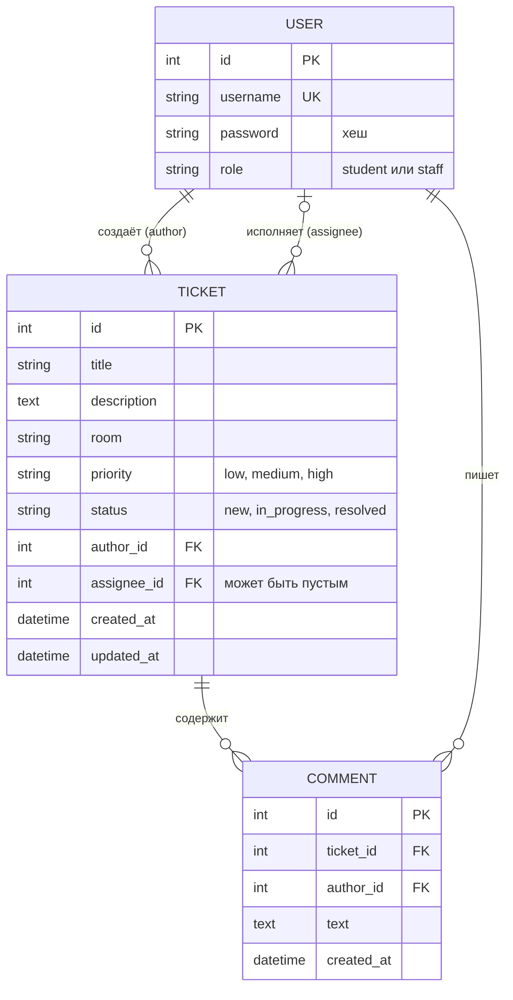

# IT-помощь колледжа

Веб-сервис для заявок на ремонт и настройку техники в колледже. Студент создаёт заявку, сотрудник IT берёт её в работу и закрывает, оба общаются в комментариях.

Семестровый проект, 3 курс. Стек: Python 3.13, Django 6.1, SQLite (по умолчанию) или PostgreSQL, HTML/CSS.

## Роли

| Роль | Как получить | Что может |
|---|---|---|
| Студент | Регистрация на сайте | Создаёт заявки, видит только свои, пишет комментарии |
| Сотрудник IT | Админ задаёт роль в `/admin/` | Видит все заявки, берёт в работу, закрывает, пишет комментарии |
| Админ | `python manage.py createsuperuser` | Управляет пользователями и заявками в `/admin/` |

Роль нельзя выбрать при регистрации: все новые пользователи становятся студентами.

## Статусы заявки

`Новая → В работе → Решена`. Назад и через этап переходить нельзя, это проверяет сервер.

## Запуск с нуля (Windows, PowerShell)

```
git clone https://github.com/Kurmanbek78/it_help.git
cd it_help
py -3.13 -m venv .venv
.venv\Scripts\activate
pip install -r requirements.txt
copy .env.example .env
```

В файле `.env` замените `SECRET_KEY` своим ключом. Сгенерировать его можно командой:

```
python -c "import secrets; print(secrets.token_urlsafe(50))"
```

Дальше:

```
python manage.py migrate
python manage.py seed
python manage.py runserver
```

Сайт: http://127.0.0.1:8000/

## Тестовые аккаунты

| Логин | Пароль | Роль |
|---|---|---|
| staff1 | Staff12345 | Сотрудник IT |
| student1 | Student12345 | Студент |
| student2 | Student12345 | Студент |

Админ создаётся командой `python manage.py createsuperuser`.
Команда `python manage.py seed` создаёт эти аккаунты и 12 демонстрационных заявок. Её можно запускать повторно.

## Тесты

```
python manage.py test
```

10 автоматических проверок: права доступа, валидация, успешный сценарий, запрещённый переход статуса, пограничные случаи.

## PostgreSQL (необязательно)

```
pip install "psycopg[binary]"
```

Затем раскомментируйте строки `DB_*` в `.env`, создайте пустую базу `it_help` и выполните `python manage.py migrate`.

## Маршруты

| URL | Методы | Доступ | Назначение |
|---|---|---|---|
| `/` | GET | все | Главная |
| `/register/` | GET, POST | все | Регистрация (роль всегда «студент») |
| `/login/` | GET, POST | все | Вход |
| `/logout/` | POST | вошедшие | Выход |
| `/tickets/` | GET | вошедшие | Список заявок: студент видит свои, сотрудник все. Параметры `q`, `status`, `page` |
| `/tickets/new/` | GET, POST | вошедшие | Создание заявки |
| `/tickets/<id>/` | GET, POST | автор или сотрудник | Заявка и комментарии (POST добавляет комментарий), чужим 403 |
| `/tickets/<id>/status/` | POST | только сотрудник | Смена статуса по разрешённым переходам |
| `/admin/` | GET, POST | админ и сотрудники с флагом Staff status | Админ-панель Django |

## ER-диаграмма



При удалении пользователя удаляются его заявки и комментарии. Если удалить исполнителя, у заявки поле исполнителя очищается.

## Известные ограничения

- Нет уведомлений, загрузки файлов и внешних сервисов.
- Исполнитель назначается автоматически тем, кто взял заявку в работу.
- Для локального запуска используется встроенный сервер Django, не для продакшена.

## Журнал разработки

**Неделя 1.** Выбор темы, список требований.

**Неделя 2.** Окружение, Git, модели пользователя, заявки и комментария, регистрация и вход, создание и список заявок, комментарии, смена статусов, дизайн, автотесты, команда наполнения данными.